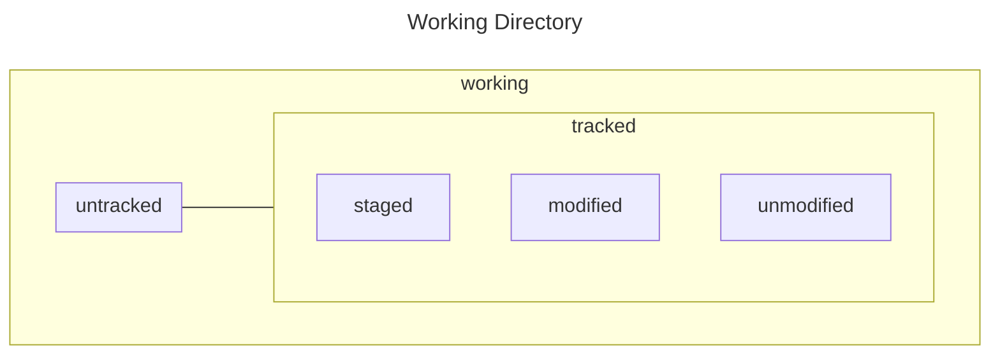
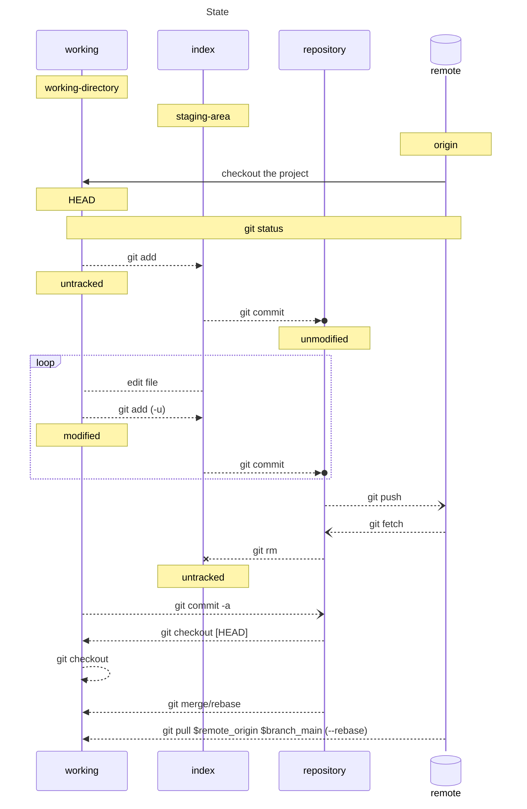

## Versionamento

| version | release       | description                     |
| :-:     | :-:           | :-:                             |
| 0.0.x   | path release  | bug fixes \| hot fix            |
| 0.x.0   | minor release | new feature                     |
| x.0.0   | major release | new system, break compatibility |

## Stages

| abbrv | Stages    | Description                                                            |
| :-: | :-: | :-: |
| U | Untracked | the file exist but is not part of repository                               |
| A | Added     | the file and changed have been added to version but not commited yet       |
| M | Modified  | the file is part of repository but has changes neither commited nor staged |
|   | Commited  | the changes has been commited                                              |

| | | |
| --- | --- | --- |
| working tree          | --worktree            | working directory with modified files |
| staging area (index)  | --cached \| --staged  | modified files added to be commited   |
| repository (HEAD)     |                       | files saved in repository             |

### Head

+ HEAD: current commit
+ HEAD~n: n back commits
+ HEAD^ = HEAD~1

## Flow

