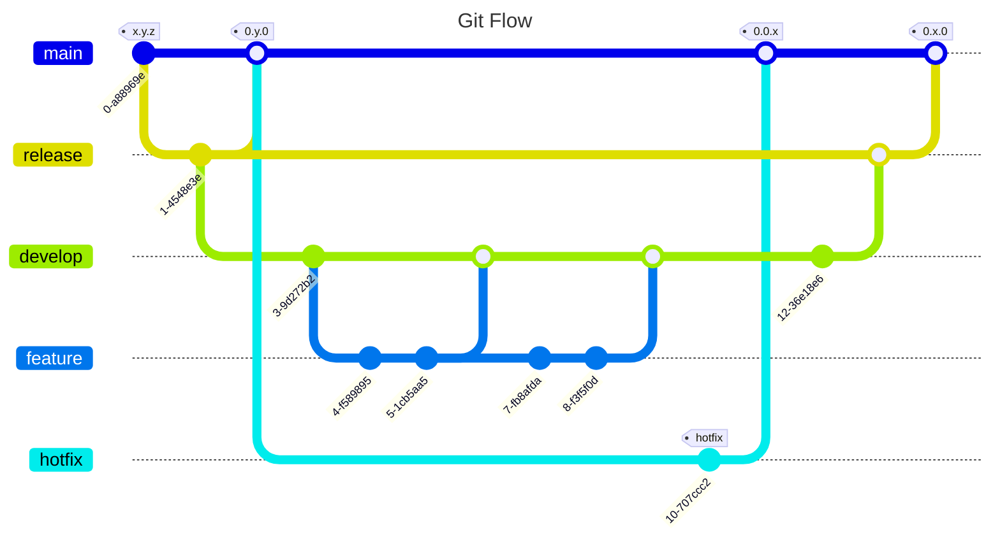

#

## Concepts

+ Default branch:               main | MASTER
+ Default upstream repo:        origin
+ Current branch:               HEAD
+ Parent of HEAD:               HEAD^
+ Great great parent of HEAD:   HEAD~4

## Co-work

1. Create a **repository** on the central server. A repository is just a folder that is being tracked by **Git Software**.
2. Download the repository on your computer. In terms of VCS, we usually refer to this step as *cloning*.
3. Add files in this repository and commit them. Git takes a snapshot of the project whenever you commit something. It then maintains a history of snapshots for later use.
4. Upload the modified files on the server.
5. Download any files that are modified by your teammates.

## Flow

